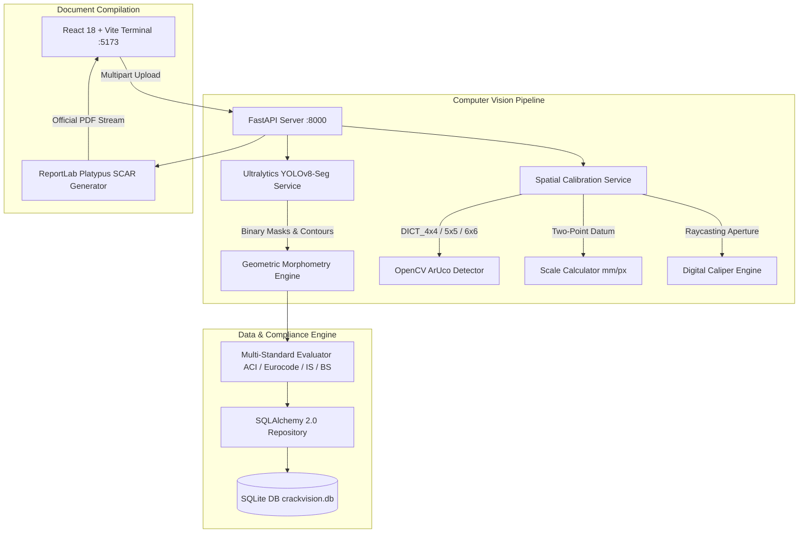

# Developer Guide & System Architecture

Welcome to **CrackVision AI** — an AI-powered civil infrastructure visual inspection system designed for structural health monitoring, crack morphometry, optical caliper measurements, and automated condition assessment reporting.

---

## 1. High-Level Architecture



---

## 2. Directory Structure

```
crackvision-ai/
├── DEVELOPER.md                # Comprehensive developer architecture and onboarding guide
├── PRODUCT.md                  # Product specifications and engineering requirements
├── README.md                   # Project overview, installation, and demonstration guide
├── .gitignore                  # Git ignore rules (dependencies, model weights, local DBs)
├── .planning/                  # Project planning, roadmaps, requirements, and milestone audits
│   ├── ROADMAP.md              # Milestone 1 & 2 execution roadmap
│   ├── REQUIREMENTS.md         # Traceable engineering requirements matrix
│   └── STATE.md                # Locked architectural decisions and system state
│
├── backend/                    # Python 3.13 + FastAPI application
│   ├── .env.example            # Environment variables template
│   ├── pytest.ini              # Pytest configuration
│   ├── requirements.txt        # Python dependency manifest
│   ├── data/                   # SQLite database storage (crackvision.db)
│   ├── app/
│   │   ├── main.py             # FastAPI entrypoint, routing, CORS, and endpoint definitions
│   │   ├── schemas.py          # Pydantic v2 request/response validation models
│   │   ├── db/                 # Relational database persistence layer
│   │   │   ├── __init__.py     # Barrel export for models, session, and repository
│   │   │   ├── session.py      # SQLAlchemy engine, connection handling, and init_db()
│   │   │   ├── models.py       # Domain models: Asset, Survey, DefectFissure
│   │   │   └── repository.py   # SurveyRepository CRUD methods
│   │   ├── services/           # Decoupled core business logic & vision services
│   │   │   ├── __init__.py     # Barrel export for all services
│   │   │   ├── crack_analyzer.py # High-level orchestration pipeline
│   │   │   ├── yolo_service.py # YOLOv8 segmentation inference and contour extraction
│   │   │   ├── calibration_service.py # ArUco detection, 2-point scale, and caliper raycasting
│   │   │   ├── morphometry.py  # Fissure orientation, aperture limits, and tie-hole filtering
│   │   │   └── pdf_generator.py # ReportLab Platypus SCAR PDF compilation engine
│   │   ├── weights/            # Deep learning model weight artifacts
│   │   │   └── crack_yolov8s_seg.pt # Trained YOLOv8 segmentation weights
│   │   └── utils/              # Utility helpers
│   ├── scripts/                # Standalone training and dataset conversion scripts
│   └── tests/                  # Automated pytest test suites (36 tests)
│       ├── test_api.py         # Health, upload validation, and core analysis tests
│       ├── test_building_age_assessment.py # 15-scenario Building Age & Context Assessment tests
│       ├── test_calibration.py # ArUco fiducials, 2-point scale, and caliper tests
│       ├── test_morphometry.py # Aspect ratio, orientation, and ACI limit tests
│       ├── test_phase5.py      # Relational DB CRUD, PDF streaming, and batch tests
│       └── test_yolo_service.py# Model loading, synthetic cracks, and device detection tests
│
└── frontend/                   # React 18 + TypeScript + Vite application
    ├── .env.example            # Frontend environment configuration template
    ├── index.html              # HTML shell
    ├── package.json            # NPM dependencies and build scripts
    ├── tailwind.config.js      # CAD theme tokens (civilNavy, safetyOrange, cad-grid)
    ├── vite.config.ts          # Vite build configuration (Port 5173)
    ├── public/                 # Static assets and sample benchmark imagery
    └── src/
        ├── App.tsx             # Root component with ErrorBoundary and Drag-and-Drop provider
        ├── main.tsx            # React DOM mounting
        ├── index.css           # Global CAD grid drafting styles and animations
        ├── components/         # Modular user interface components
        │   ├── index.ts        # Clean barrel export for all UI components
        │   ├── Navbar.tsx      # Terminal header, system status, and modal triggers
        │   ├── Hero.tsx        # System banner and preset benchmark selector
        │   ├── ImageUploader.tsx # Single & batch drag-and-drop CAD dropzone
        │   ├── ImagePreview.tsx # Interactive canvas with SVG masks, ArUco HUD, and Caliper tool
        │   ├── CaliperSamplesTable.tsx # Digital caliper localized probe log
        │   ├── AnalysisResults.tsx # Full SCAR report, comparator scale, and PDF actions
        │   ├── BatchAnalysisView.tsx # Aggregated batch inspection KPI cards and gallery
        │   ├── AnalysisHistory.tsx # SQLite-synced survey logbook with instant PDF downloads
        │   ├── CrackComparatorCard.tsx # ACI 224R-01 optical comparator scale
        │   ├── SeverityBadge.tsx # Standardized distress severity pill indicator
        │   ├── AnalysisLoader.tsx # Diagnostic loading animation
        │   └── Footer.tsx      # Civil standards specification footer
        ├── pages/
        │   └── Dashboard.tsx   # Main terminal controller coordinating workflows
        ├── services/
        │   └── api.ts          # Strongly-typed fetch client for all backend endpoints
        ├── types/
        │   └── analysis.ts     # Domain TypeScript interfaces (AnalysisResult, Batch, Caliper)
        └── data/
            └── sampleImages.ts # Pre-calibrated field inspection benchmark cases
```

---

## 3. Developer Quickstart

### Prerequisites
- **Python**: 3.10+ (tested on Python 3.13)
- **Node.js**: 18+ and `npm`

### 1. Backend Setup
```bash
cd backend

# Create virtual environment
python3 -m venv venv
source venv/bin/activate  # On Windows: venv\Scripts\activate

# Install dependencies
pip install -r requirements.txt

# Start backend server on port 8000
uvicorn app.main:app --reload --port 8000
```
- Interactive Swagger UI: [http://localhost:8000/docs](http://localhost:8000/docs)
- Interactive ReDoc: [http://localhost:8000/redoc](http://localhost:8000/redoc)
- SQLite database initializes automatically at: `backend/data/crackvision.db`

### 2. Frontend Setup
```bash
cd frontend

# Install packages
npm install

# Start Vite dev server on port 5173
npm run dev
```
- Open browser at: [http://localhost:5173](http://localhost:5173)

---

## 4. Primary API Endpoints

| Method | Endpoint | Description |
|---|---|---|
| `GET` | `/health` | System health check, device status, and calibration capabilities |
| `POST` | `/analyze` | Single image inspection with YOLOv8-Seg and auto-persistence to DB |
| `POST` | `/analyze/batch` | Multi-image inspection returning aggregated metrics and critical alerts |
| `POST` | `/calibrate/two-point` | Computes mm/pixel spatial resolution from 2 points and a known dimension |
| `POST` | `/calibrate/probe-aperture` | Samples localized crack width normal to fissure tangent at coordinate |
| `GET` | `/api/surveys` | Lists inspection surveys with optional severity and standard filters |
| `POST` | `/api/surveys` | Manually records or updates an inspection survey |
| `GET` | `/api/surveys/{id}` | Fetches full survey record by ID |
| `DELETE` | `/api/surveys/{id}` | Deletes a survey record from SQLite database |
| `GET` | `/api/surveys/{id}/pdf` | Generates and streams official SCAR PDF from database record |
| `POST` | `/api/surveys/export-pdf`| Compiles and streams official SCAR PDF directly from client JSON payload |
| `GET` | `/api/assets` | Lists registered infrastructure asset tags |
| `POST` | `/api/assets` | Creates a new infrastructure asset record |

---

## 5. Key Design Principles for Contributors

1. **Port Isolation**: Always keep backend on port **8000** and frontend on port **5173** to avoid collision with other local web services.
2. **Decoupled Architecture**: Services in `backend/app/services/` should remain self-contained with minimal coupling to FastAPI request objects.
3. **Engineering Rigor & Disclaimers**: CrackVision AI is an AI-assisted preliminary assessment tool. UI and PDF outputs must include professional engineering disclaimers adhering to ACI 224R guidelines.
4. **Barrel Exports**: Use `from app.services import ...` in Python and `import { ... } from '../components'` in TypeScript to maintain clean imports.
5. **Quality Verification**: Run the automated test suites before committing changes:
   ```bash
   # Run all backend tests
   ./backend/venv/bin/pytest backend/tests

   # Verify frontend build
   cd frontend && npm run build
   ```
